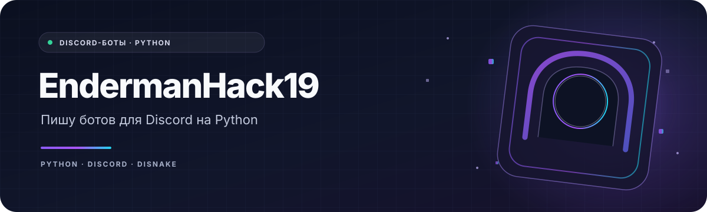

  

<h1 align="center">Привет! Я EndermanHack19 👋</h1>

  Пишу ботов и команды для Discord на Python и Disnake. 
  ALPHA и AniLand Company — мои проекты.

  
  
  

  
  
  

---

## Немного обо мне

Занимаюсь Discord-ботами: пишу на Python и обычно использую Disnake. **AniLand Company — мой проект, я веду его один.** Там не один большой бот, а несколько отдельных репозиториев: настройка приватных голосовых комнат, команда `/server`, реакции, команда `/emoji` и статистика Rust.

**ALPHA** — мой Discord-бот с веб-панелью. В панели можно настроить автомодерацию. Ссылки на сайт, настройки и приглашение бота оставил в карточке ниже.

## Проекты

<table>
  <tr>
    <td width="50%" valign="top">
      <h3>🤖 ALPHA</h3>
      
Мой Discord-бот с веб-панелью. В разделе автомодерации можно настроить правила для сервера.

      

        <a href="https://alpha-bot.su/">Сайт</a> ·
        <a href="https://alpha-bot.su/dashboard/711918264665636927/automod">Панель автомодерации</a> ·
        <a href="https://endermanhack19.alpha-bot.su/">Страница бота</a> ·
        <a href="https://discord.com/oauth2/authorize?client_id=1309175069846802452">Добавить на сервер</a>
      

    </td>
    <td width="50%" valign="top">
      <h3>🌐 AniLand Company</h3>
      
Веду проект один. В репозиториях лежат отдельные команды для Discord, а не один общий бот.

      

        <a href="https://github.com/AniLand-company">Все репозитории</a> ·
        <a href="https://github.com/AniLand-company/server-commands">Команда /server</a> ·
        <a href="https://github.com/AniLand-company/reactions">Реакции</a> ·
        <a href="https://github.com/AniLand-company/emoji">Команда /emoji</a> ·
        <a href="https://github.com/AniLand-company/order">Заказ услуги</a>
      

    </td>
  </tr>
  <tr>
    <td width="50%" valign="top">
      <h3>🦀 Rust Stats</h3>
      
Команда для просмотра статистики Rust-игрока в Discord: игровое время, K/D, убийства и другие показатели. Разделы переключаются кнопками.

      
<a href="https://github.com/AniLand-company/Rust-Stats">Репозиторий Rust Stats</a>

    </td>
    <td width="50%" valign="top">
      <h3>🔊 Voice Rooms</h3>
      
Команда <code>/voice</code> для настройки приватных голосовых комнат. Настраивать её может администратор сервера.

      
<a href="https://github.com/AniLand-company/voice">Репозиторий Voice Rooms</a>

    </td>
  </tr>
</table>

---

Спасибо, что заглянул! 👋

